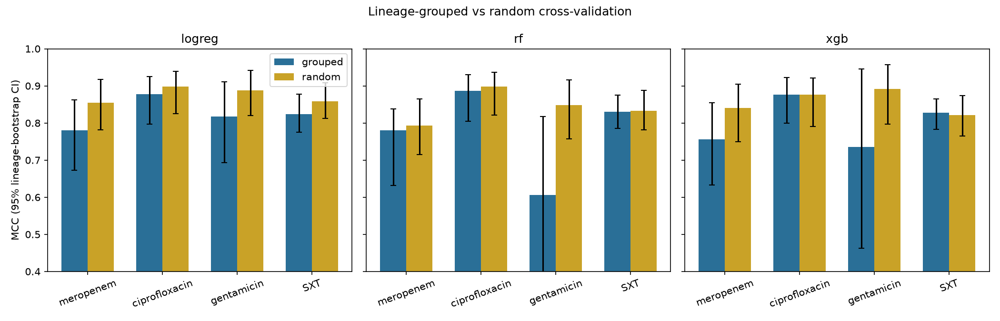
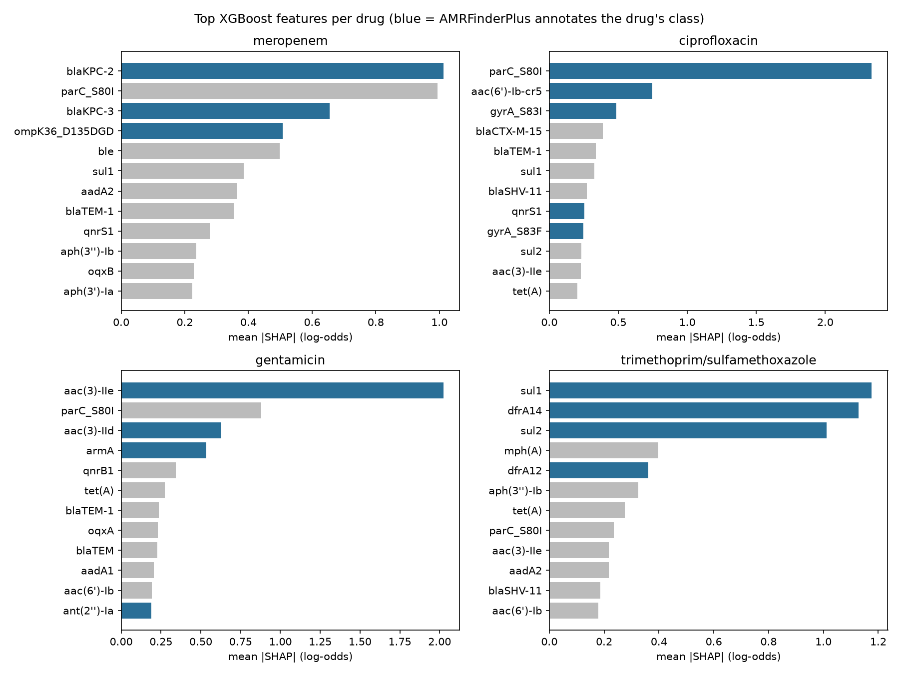

# Predicting antibiotic resistance from *Klebsiella pneumoniae* genomes

Can a genome's set of known resistance genes and mutations predict whether the
isolate is resistant to an antibiotic, when the model is tested on bacterial
lineages it has never seen? And do the model's most important features match
known resistance mechanisms?

This project trains per-drug classifiers on 500 *K. pneumoniae* genomes from
BV-BRC with laboratory-measured phenotypes for four antibiotics. Features are
AMRFinderPlus gene and point-mutation calls. All validation is grouped by Mash
lineage, and a random split is run alongside to show how much leakage inflates
the scores.

## Main results

XGBoost, 5-fold cross-validation grouped by lineage (131 Mash lineage groups,
threshold 0.005). Confidence intervals are 95 % intervals from a bootstrap that
resamples whole lineage groups (1,000 resamples).

| Drug | n R / S | AUROC (95 % CI) | F1 | MCC |
|---|---|---|---|---|
| meropenem | 155 / 345 | 0.948 (0.895–0.974) | 0.833 | 0.756 |
| ciprofloxacin | 319 / 181 | 0.975 (0.940–0.990) | 0.954 | 0.877 |
| gentamicin | 182 / 318 | 0.951 (0.869–0.987) | 0.836 | 0.736 |
| trimethoprim/sulfamethoxazole | 301 / 199 | 0.972 (0.960–0.981) | 0.933 | 0.828 |

All three models under lineage-grouped CV (AUROC / MCC):

| Drug | Logistic regression | Random forest | XGBoost |
|---|---|---|---|
| meropenem | 0.951 / 0.781 | 0.954 / 0.781 | 0.948 / 0.756 |
| ciprofloxacin | 0.981 / 0.878 | 0.977 / 0.886 | 0.975 / 0.877 |
| gentamicin | 0.955 / 0.817 | 0.921 / 0.607 | 0.951 / 0.736 |
| trimethoprim/sulfamethoxazole | 0.976 / 0.824 | 0.972 / 0.830 | 0.972 / 0.828 |

The three models overlap within their confidence intervals. With known
resistance determinants as features, a regularised logistic regression is as
good as the tree ensembles. Full results, with all CIs, are in
[`reports/per_drug_results.csv`](reports/per_drug_results.csv).

### Leakage: random split vs lineage-grouped split

| Drug | Model | AUROC grouped → random | MCC grouped → random |
|---|---|---|---|
| gentamicin | rf | 0.921 → 0.968 | 0.607 → 0.848 |
| gentamicin | xgb | 0.951 → 0.968 | 0.736 → 0.892 |
| meropenem | xgb | 0.948 → 0.967 | 0.756 → 0.840 |
| meropenem | logreg | 0.951 → 0.964 | 0.781 → 0.854 |
| trimethoprim/sulfamethoxazole | xgb | 0.972 → 0.972 | 0.828 → 0.821 |

A random split gave a higher AUROC in 11 of 12 model–drug pairs. The AUROC gap is
small (at most +0.047), but threshold-based metrics move much more: MCC rises by
up to 0.24. The dataset contains 86 near-identical genome pairs (Mash distance
below 0.0001), which a random split can place on both sides of the train/test
boundary. The inflation stays modest because the features are resistance
determinants that move between lineages on plasmids, not lineage markers.



### Transfer to an unseen study

XGBoost trained on every other BioProject and tested on PRJEB27256 (146 genomes):

| Drug | AUROC | R in held-out study |
|---|---|---|
| ciprofloxacin | 0.959 | 40 |
| gentamicin | 0.981 | 27 |
| trimethoprim/sulfamethoxazole | 0.962 | 48 |
| meropenem | not evaluable | the held-out study had only one class |

## Do the top features match known resistance mechanisms?

SHAP values come from `shap` 0.51 `TreeExplainer` on an XGBoost model fitted on
all 500 genomes for each drug. "Matches" means AMRFinderPlus (NCBI Reference Gene
Catalog) annotates the element with the drug's class. Full table:
[`reports/shap_top_features.csv`](reports/shap_top_features.csv).

| Drug | Top features (rank) | Agreement | Surprises |
|---|---|---|---|
| meropenem | blaKPC-2 (1), blaKPC-3 (3), ompK36_D135DGD (4) | KPC carbapenemases and an OmpK36 porin alteration | parC_S80I (2), ble, sul1, aadA2 rank highly |
| ciprofloxacin | parC_S80I (1), aac(6')-Ib-cr5 (2), gyrA_S83I (3), qnrS1, gyrA_S83F | target-site mutations, plus plasmid quinolone genes | blaCTX-M-15, blaTEM-1, sul1 |
| gentamicin | aac(3)-IIe (1), aac(3)-IId (3), armA (4) | gentamicin-modifying enzymes and a 16S rRNA methyltransferase | parC_S80I (2), qnrB1, tet(A) |
| trimethoprim/sulfamethoxazole | sul1 (1), dfrA14 (2), sul2 (3), dfrA12 (5) | both halves of the combination: *sul* and *dfr* genes | mph(A), aph(3'')-Ib, tet(A) |

**Agreement:** for every drug, the top-ranked feature is a determinant that NCBI
assigns to that drug's class. Among the top 10, 3 (meropenem), 5 (ciprofloxacin),
3 (gentamicin) and 4 (trimethoprim/sulfamethoxazole) match.

**Surprises are mostly co-occurrence, not mechanism.** parC_S80I is the
second-strongest feature for meropenem and gentamicin, even though a quinolone
target mutation should not affect either drug. It is present in 87 % of
meropenem-resistant genomes and 31 % of susceptible ones. This pattern suggests
it marks multidrug-resistant high-risk clones, where resistance to several
drugs travels together. The same applies to *sul1*, *tet(A)* and *mph(A)*, which
often sit on the same plasmids and integrons as the true determinants. SHAP
explains what the model uses, not what causes resistance.

A note on one gene: aac(6')-Ib (amikacin/kanamycin/tobramycin) does not appear
among the top gentamicin features, while aac(3) genes and armA do. This fits
their annotated substrate ranges.

Each gene-drug link above still needs checking against
[CARD](https://card.mcmaster.ca) and the
[NCBI Reference Gene Catalog](https://www.ncbi.nlm.nih.gov/pathogens/refgene/);
the `verified_in_CARD` column of the SHAP table is there for that.



## Data

| Item | Detail |
|---|---|
| Phenotypes | BV-BRC `PATRIC_genomes_AMR.txt` (1,207,585 rows), downloaded 2026-10-31 from `ftp.bv-brc.org/RELEASE_NOTES` |
| Genome metadata | BV-BRC `genome_metadata` (file dated 2024-09-13; covered all labelled genomes) |
| Assemblies | BV-BRC HTTPS data API (`genome_sequence`), with every download checked against the expected contig count and length |
| Species | taxon IDs 573 and 72407 |
| Evidence | laboratory AST only (`antimicrobial_resistance_evidence` = "AMR Panel") |
| Tools | AMRFinderPlus 4.2.7, database 2026-08-07.1, `-O Klebsiella_pneumoniae --plus`; Mash 2.3 |

### From 8,436 genomes to 500

1. *K. pneumoniae* genomes with an AMR record: 8,436.
2. Genomes with usable labels for all four drugs, after dropping Intermediate
   calls and conflicting genome–drug pairs: 3,045.
3. After assembly QC: 2,973. QC removed genomes that were deprecated, outside
   5.0–6.3 Mb, outside 56–58 % GC, or had more than 500 contigs. Thresholds came
   from the observed 1st–99th percentiles.
4. After keeping one assembly per BioSample: 2,966.
5. Random sample of 500 (seed 42), at most 150 genomes per BioProject. One
   BioProject held 45 % of the candidates.

Full reasoning for each choice: [`docs/week5_decisions.md`](docs/week5_decisions.md).

### Features and validation

- **Features:** presence/absence of every AMRFinderPlus element with
  `Type = AMR`. That gives 289 elements: acquired genes, point mutations and
  disruptions. Virulence, stress, metal and biocide hits are excluded. Elements
  in fewer than 1 % or more than 99 % of training genomes are dropped *inside each
  fold*, so test genomes never influence feature selection.
- **Lineages:** single-linkage clustering of all-vs-all Mash distances at 0.005,
  which gives 131 groups, the largest holding 17 % of genomes. Looser thresholds
  chain almost the whole species into one group (0.01 gives 96 %).
- **Cross-validation:** `StratifiedGroupKFold` (5 folds) on lineage groups, and
  `StratifiedKFold` (5 folds) for the random-split comparison.
- **Class imbalance:** class weights (`class_weight="balanced"`, or XGBoost's
  `scale_pos_weight`), computed on each training fold. No resampling.
- **Metrics:** AUROC (threshold-free ranking), F1 and MCC at a 0.5 threshold.
  Accuracy is not reported. With up to 69 % in one class, a model that always
  predicts the majority class would look deceptively good, whereas MCC stays near
  0 for such a model.

## Limitations

- **Sample size:** 500 genomes rather than the planned 1,200, because of compute
  time on a laptop. Confidence intervals are correspondingly wide (e.g.
  gentamicin AUROC 0.869–0.987).
- **Label noise:** phenotypes come from mixed standards (CLSI, EUCAST, BSAC) and
  years. 38,179 MIC-only records were not re-interpreted, and Intermediate
  calls were dropped.
- **Sampling bias:** two BioProjects provide 296 of the 500 genomes. The
  held-out-study test addresses this for three drugs, but not meropenem.
- **Feature design:** presence/absence only. Allele variants are separate
  features (e.g. `oqxA` vs `oqxA11`). Resistance from gene expression, copy
  number or novel mechanisms is invisible to the model.
- **Interpretation:** SHAP shows association within this dataset. Co-carried
  genes on multidrug-resistance plasmids rank highly without causing resistance
  to the drug in question.
- **Lineage threshold:** single linkage at 0.005 was chosen from the data
  (strictest grouping before chaining), not from an external lineage definition
  such as MLST.

## Reproducing

```bash
# environments
mamba env create -f environment.yml
mamba env create -n amr-amrfinder -f workflow/envs/amrfinder.yaml
mamba env create -n amr-mash -f workflow/envs/mash.yaml
conda activate amr-amrfinder && amrfinder_update -d data/amrfinder_db && conda activate amr

# data: labels, QC and sampling (needs the two BV-BRC metadata files in data/metadata/)
python -m src.select_genomes labels
python -m src.select_genomes qc-report
python -m src.select_genomes select --n 500 --max-per-project 150 \
    --out data/metadata/selected_500.tsv --ids-out data/metadata/genome_ids_500.txt
bash workflow/scripts/download_genomes.sh data/metadata/selected_500.tsv data/genomes

# everything else: AMRFinderPlus, Mash, lineages, matrix, training, SHAP
export PATH="$CONDA_PREFIX/../amr-amrfinder/bin:$CONDA_PREFIX/../amr-mash/bin:$PATH"
snakemake -s workflow/Snakefile --cores 6 report --config only_present=False

pytest -q   # 22 tests
```

The committed `data/metadata/selected_500.tsv` fixes the exact genome set and
labels, so the download and everything after it can be repeated without
re-running the selection.

## Repository layout

```
src/select_genomes.py   labels, QC, BioSample dedup, capped sampling
src/build_matrix.py     AMRFinderPlus reports -> presence/absence matrix
src/lineages.py         Mash distances -> lineage groups
src/train.py            grouped vs random CV, bootstrap CIs, held-out study
src/explain.py          SHAP top features vs NCBI class annotation
workflow/Snakefile      AMRFinderPlus, Mash, matrix, train, explain
workflow/scripts/       genome download (HTTPS API)
docs/                   decisions record, reference notes
reports/                results tables, figures, run summaries
tests/                  pytest suite
```
